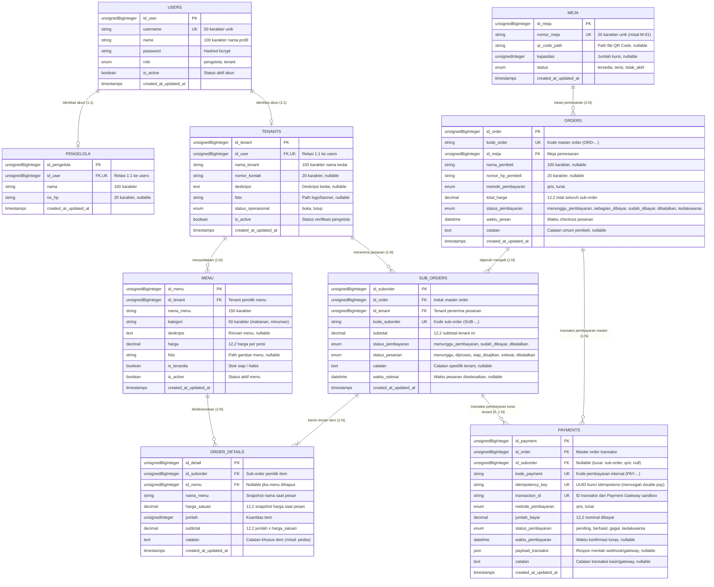

# Dokumentasi Arsitektur Database dan ERD KuponGo

Dokumen ini merupakan referensi resmi arsitektur basis data, Entity Relationship Diagram (ERD), relasi antarentitas, kamus data, serta standarisasi nilai status transaksi untuk sistem **KuponGo** (Sentra Kuliner D'Kupon).

Dokumentasi ini ditujukan bagi seluruh pengembang modul (Pembeli, Tenant, dan Pengelola) pada **Kelompok 38 Capstone Design Project**.

---

## 1. Diagram Entity Relationship (ERD)

Diagram di bawah ini menggambarkan sembilan (9) entitas inti sistem KuponGo beserta kardinalitas dan relasi antartabel:

---

## 2. Kamus Data dan Spesifikasi Tabel

### 2.1. Tabel `users`
Menyimpan kredensial autentikasi sistem berbasis peran (*Role-Based Access Control*).

| Kolom | Tipe Data | Constraint | Keterangan |
|---|---|---|---|
| `id_user` | `unsignedBigInteger` | `PRIMARY KEY`, `AUTO_INCREMENT` | Identitas unik akun |
| `username` | `varchar(50)` | `UNIQUE`, `NOT NULL` | Username unik untuk login |
| `name` | `varchar(100)` | `NULLABLE` | Nama profil pengguna |
| `password` | `varchar(255)` | `NOT NULL` | Kata sandi terenkripsi (Bcrypt) |
| `role` | `enum('pengelola', 'tenant')` | `NOT NULL` | Peran hak akses |
| `is_active` | `boolean` | `DEFAULT true`, `NOT NULL` | Status keaktifan akun |
| `remember_token` | `varchar(100)` | `NULLABLE` | Token remember-me Laravel |
| `created_at` / `updated_at` | `timestamp` | `NULLABLE` | Jejak waktu pembuatan & modifikasi |

### 2.2. Tabel `pengelola`
Profil personal pengelola Sentra Kuliner D'Kupon yang terhubung 1:1 dengan akun pengguna.

| Kolom | Tipe Data | Constraint | Keterangan |
|---|---|---|---|
| `id_pengelola` | `unsignedBigInteger` | `PRIMARY KEY`, `AUTO_INCREMENT` | Identitas pengelola |
| `id_user` | `unsignedBigInteger` | `UNIQUE`, `FOREIGN KEY` (users) | Relasi 1:1 ke tabel users (`ON DELETE CASCADE`) |
| `nama` | `varchar(100)` | `NOT NULL` | Nama lengkap pengelola |
| `no_hp` | `varchar(20)` | `NULLABLE` | Kontak pengelola |
| `created_at` / `updated_at` | `timestamp` | `NULLABLE` | Jejak waktu |

### 2.3. Tabel `tenants`
Profil entitas kedai kuliner di Sentra Kuliner D'Kupon.

| Kolom | Tipe Data | Constraint | Keterangan |
|---|---|---|---|
| `id_tenant` | `unsignedBigInteger` | `PRIMARY KEY`, `AUTO_INCREMENT` | Identitas kedai tenant |
| `id_user` | `unsignedBigInteger` | `UNIQUE`, `FOREIGN KEY` (users) | Relasi 1:1 ke tabel users (`ON DELETE CASCADE`) |
| `nama_tenant` | `varchar(100)` | `NOT NULL` | Nama warung/kedai tenant |
| `nomor_kontak` | `varchar(20)` | `NULLABLE` | Kontak kedai/penanggung jawab |
| `deskripsi` | `text` | `NULLABLE` | Deskripsi singkat kuliner |
| `foto` | `varchar(255)` | `NULLABLE` | Path file logo/foto kedai |
| `status_operasional` | `enum('buka', 'tutup')` | `DEFAULT 'tutup'`, `NOT NULL` | Status buka/tutup mandiri oleh tenant |
| `is_active` | `boolean` | `DEFAULT true`, `NOT NULL` | Status persetujuan/keaktifan dari pengelola |
| `created_at` / `updated_at` | `timestamp` | `NULLABLE` | Jejak waktu |

### 2.4. Tabel `meja`
Data meja fisik Sentra Kuliner D'Kupon beserta identitas QR Code.

| Kolom | Tipe Data | Constraint | Keterangan |
|---|---|---|---|
| `id_meja` | `unsignedBigInteger` | `PRIMARY KEY`, `AUTO_INCREMENT` | Identitas meja |
| `nomor_meja` | `varchar(20)` | `UNIQUE`, `NOT NULL` | Nomor/label meja (misal "01", "A-12") |
| `qr_code_path` | `varchar(255)` | `NULLABLE` | Path lokasi berkas gambar QR Code |
| `kapasitas` | `unsignedInteger` | `NULLABLE` | Estimasi kapasitas kursi |
| `status` | `enum('tersedia', 'terisi', 'tidak_aktif')` | `DEFAULT 'tersedia'`, `NOT NULL` | Ketersediaan meja |
| `created_at` / `updated_at` | `timestamp` | `NULLABLE` | Jejak waktu |

### 2.5. Tabel `menu`
Katalog makanan dan minuman yang dikelola oleh masing-masing tenant.

| Kolom | Tipe Data | Constraint | Keterangan |
|---|---|---|---|
| `id_menu` | `unsignedBigInteger` | `PRIMARY KEY`, `AUTO_INCREMENT` | Identitas menu |
| `id_tenant` | `unsignedBigInteger` | `FOREIGN KEY` (tenants) | Tenant pemilik menu (`ON DELETE RESTRICT`) |
| `nama_menu` | `varchar(150)` | `NOT NULL` | Nama sajian menu |
| `kategori` | `varchar(50)` | `NULLABLE` | Kategori (makanan, minuman, camilan) |
| `deskripsi` | `text` | `NULLABLE` | Rincian bahan/sajian |
| `harga` | `decimal(12,2)` | `NOT NULL` | Harga per porsi saat ini |
| `foto` | `varchar(255)` | `NULLABLE` | Path gambar foto menu |
| `is_tersedia` | `boolean` | `DEFAULT true`, `NOT NULL` | Ketersediaan porsi/stok harian |
| `is_active` | `boolean` | `DEFAULT true`, `NOT NULL` | Keberadaan menu di katalog publik |
| `created_at` / `updated_at` | `timestamp` | `NULLABLE` | Jejak waktu |

### 2.6. Tabel `orders` (Master Order)
Header pesanan utama yang mewakili satu sesi checkout pembeli di meja tertentu (mendukung *multi-tenant single cart*).

| Kolom | Tipe Data | Constraint | Keterangan |
|---|---|---|---|
| `id_order` | `unsignedBigInteger` | `PRIMARY KEY`, `AUTO_INCREMENT` | Identitas master order |
| `kode_order` | `varchar(50)` | `UNIQUE`, `NOT NULL` | Kode unik pesanan (misal `ORD-20261112-0001`) |
| `id_meja` | `unsignedBigInteger` | `FOREIGN KEY` (meja) | Meja pemesanan (`ON DELETE RESTRICT`) |
| `nama_pembeli` | `varchar(100)` | `NULLABLE` | Nama pemesan saat checkout |
| `nomor_hp_pembeli` | `varchar(20)` | `NULLABLE` | Nomor WhatsApp pembeli |
| `metode_pembayaran` | `enum('qris', 'tunai')` | `NOT NULL` | Metode pembayaran terpilih |
| `total_harga` | `decimal(12,2)` | `DEFAULT 0.00`, `NOT NULL` | Akumulasi total harga seluruh sub-order |
| `status_pembayaran` | `enum('menunggu_pembayaran', 'sebagian_dibayar', 'sudah_dibayar', 'dibatalkan', 'kedaluwarsa')` | `DEFAULT 'menunggu_pembayaran'` | Agregasi status pembayaran master |
| `waktu_pesan` | `datetime` | `NOT NULL` | Waktu pembeli menekan checkout |
| `catatan` | `text` | `NULLABLE` | Catatan umum transaksi |
| `created_at` / `updated_at` | `timestamp` | `NULLABLE` | Jejak waktu |

### 2.7. Tabel `sub_orders` (Sub-Order per Tenant)
Partisi pesanan utama yang diteruskan ke masing-masing dapur tenant terkait.

| Kolom | Tipe Data | Constraint | Keterangan |
|---|---|---|---|
| `id_suborder` | `unsignedBigInteger` | `PRIMARY KEY`, `AUTO_INCREMENT` | Identitas sub-order |
| `id_order` | `unsignedBigInteger` | `FOREIGN KEY` (orders) | Master order induk (`ON DELETE RESTRICT`) |
| `id_tenant` | `unsignedBigInteger` | `FOREIGN KEY` (tenants) | Tenant penerima (`ON DELETE RESTRICT`) |
| `kode_suborder` | `varchar(60)` | `UNIQUE`, `NOT NULL` | Kode sub-order unik (misal `SUB-ORD-0001-T1`) |
| `subtotal` | `decimal(12,2)` | `DEFAULT 0.00`, `NOT NULL` | Total nominal untuk tenant ini |
| `status_pembayaran` | `enum('menunggu_pembayaran', 'sudah_dibayar', 'dibatalkan')` | `DEFAULT 'menunggu_pembayaran'` | Status lunas sub-order ini |
| `status_pesanan` | `enum('menunggu', 'diproses', 'siap_disajikan', 'selesai', 'dibatalkan')` | `DEFAULT 'menunggu'` | Tahap pengerjaan dapur tenant |
| `catatan` | `text` | `NULLABLE` | Catatan pesanan khusus tenant |
| `waktu_selesai` | `datetime` | `NULLABLE` | Waktu pesanan ditandai selesai |
| `created_at` / `updated_at` | `timestamp` | `NULLABLE` | Jejak waktu |
| *Composite Key* | `(id_suborder, id_order)` | `UNIQUE` | Menjamin integritas referensi komposit payments |

### 2.8. Tabel `order_details` (Item Rincian Pesanan)
Daftar menu individual yang dipesan dalam satu sub-order, dilengkapi pencatatan historis (*snapshot*).

| Kolom | Tipe Data | Constraint | Keterangan |
|---|---|---|---|
| `id_detail` | `unsignedBigInteger` | `PRIMARY KEY`, `AUTO_INCREMENT` | Identitas detail item |
| `id_suborder` | `unsignedBigInteger` | `FOREIGN KEY` (sub_orders) | Sub-order pemilik (`ON DELETE RESTRICT`) |
| `id_menu` | `unsignedBigInteger` | `FOREIGN KEY` (menu), `NULLABLE` | Referensi menu master (`ON DELETE SET NULL`) |
| `nama_menu` | `varchar(150)` | `NOT NULL` | **Snapshot** nama menu saat dipesan |
| `harga_satuan` | `decimal(12,2)` | `NOT NULL` | **Snapshot** harga menu saat dipesan |
| `jumlah` | `unsignedInteger` | `NOT NULL` | Jumlah porsi yang dipesan |
| `subtotal` | `decimal(12,2)` | `NOT NULL` | Nominal (`jumlah * harga_satuan`) |
| `catatan` | `text` | `NULLABLE` | Catatan kustomisasi item (misal "tidak pedas") |
| `created_at` / `updated_at` | `timestamp` | `NULLABLE` | Jejak waktu |

### 2.9. Tabel `payments` (Catatan Pembayaran & Transaksi)
Menyimpan jejak pembayaran baik untuk skenario satu kali QRIS (master order) maupun pembayaran tunai mandiri per tenant.

| Kolom | Tipe Data | Constraint | Keterangan |
|---|---|---|---|
| `id_payment` | `unsignedBigInteger` | `PRIMARY KEY`, `AUTO_INCREMENT` | Identitas catatan pembayaran |
| `id_order` | `unsignedBigInteger` | `FOREIGN KEY` (orders) | Master order terkait (`ON DELETE RESTRICT`) |
| `id_suborder` | `unsignedBigInteger` | `FOREIGN KEY` (sub_orders), `NULLABLE` | `NULL` untuk QRIS master; jika tunai, terikat komposit `(id_suborder, id_order)` (`ON DELETE RESTRICT`) |
| `kode_payment` | `varchar(60)` | `UNIQUE`, `NOT NULL` | Kode referensi pembayaran internal |
| `idempotency_key` | `varchar(100)` | `UNIQUE`, `NULLABLE` | Kunci idempotensi untuk mencegah pembayaran ganda |
| `transaction_id` | `varchar(100)` | `UNIQUE`, `NULLABLE` | ID transaksi resmi dari payment gateway sandbox |
| `metode_pembayaran` | `enum('qris', 'tunai')` | `NOT NULL` | Kanal pembayaran |
| `jumlah_bayar` | `decimal(12,2)` | `NOT NULL` | Nominal uang yang dibayarkan |
| `status_pembayaran` | `enum('pending', 'berhasil', 'gagal', 'kedaluwarsa')` | `DEFAULT 'pending'` | Status eksekusi transaksi |
| `waktu_pembayaran` | `datetime` | `NULLABLE` | Waktu transaksi berhasil diverifikasi |
| `payload_transaksi` | `json` | `NULLABLE` | Data mentah respon webhook payment gateway |
| `catatan` | `text` | `NULLABLE` | Catatan tambahan |
| `created_at` / `updated_at` | `timestamp` | `NULLABLE` | Jejak waktu |

---

## 3. Keputusan Arsitektural & Perubahan dari ERD Proposal Awal

Berikut adalah alasan teknis di balik penyesuaian dan penyempurnaan skema database:

1. **Keamanan Riwayat Transaksi (`ON DELETE RESTRICT`):**
   - *Prinsip Finansial:* Catatan keuangan, pesanan, dan pembayaran tidak boleh terhapus dari basis data secara tidak sengaja (*anti-accidental data loss*).
   - *Implementasi Restrict:* Aturan `cascade` pada relasi `orders -> sub_orders`, `sub_orders -> order_details`, dan `orders/sub_orders -> payments` telah diubah menjadi **`ON DELETE RESTRICT`**.
   - *Dampak:* Master order atau sub-order yang telah memiliki riwayat pesanan atau pembayaran **ditolak secara mutlak oleh database engine** jika ada upaya penghapusan (*hard delete*). Pembatalan transaksi wajib menggunakan perubahan status (`dibatalkan`), bukan penghapusan baris data.

2. **Snapshot Histori Menu pada `order_details` (`nama_menu`, `harga_satuan`):**
   - *Masalah awal:* Pada rancangan awal proposal, `order_details` hanya menyimpan `id_menu`. Jika suatu hari tenant menaikkan harga atau mengubah nama menu, laporan keuangan dan riwayat transaksi pembeli di masa lampau akan terdistorsi mengikuti data terbaru.
   - *Solusi:* Kolom `nama_menu` dan `harga_satuan` disimpan secara permanen pada saat *checkout*. Perubahan harga master di kemudian hari tidak akan mengubah nilai transaksi historis.
   - *Integritas Foreign Key:* `id_menu` dibuat `NULLABLE` dengan constraint `ON DELETE SET NULL`. Jika menu dihapus dari sistem, detail transaksi tetap utuh dan laporan keuangan tidak rusak.

3. **Integritas Pembayaran Multi-Tenant (QRIS vs Tunai):**
   - *Aturan Transaksi QRIS:* Pembeli membayar satu kali akumulasi belanja seluruh tenant melalui kode QRIS master. Kolom `payments.id_suborder` bernilai `NULL` karena pembayaran berlaku untuk master order secara keseluruhan. Saat pembayaran valid, seluruh `sub_orders` otomatis terupdate menjadi `sudah_dibayar`.
   - *Aturan Transaksi Tunai:* Pembeli membayar langsung ke kasir masing-masing tenant. Kolom `payments.id_suborder` **wajib terisi** dengan ID sub-order yang dibayarkan.
   - *Validasi Konsistensi Master Order & Sub-Order:* Untuk menjamin bahwa sub-order yang dibayar benar-benar berada di bawah master order yang sama:
     - **Tingkat Basis Data:** Menggunakan *Composite Foreign Key* pada `payments(id_suborder, id_order)` yang merujuk langsung ke *Composite Unique Key* `sub_orders(id_suborder, id_order)`.
     - **Tingkat Model (Eloquent):** Event hook `Payment::saving()` melakukan validasi otomatis bahwa `sub_order->id_order === payment->id_order` sebelum query dieksekusi.

4. **Pencegahan Pembayaran Ganda (*Double Payment Prevention*):**
   - *Keterbatasan Idempotency Key:* Perlu ditegaskan bahwa `idempotency_key` pada tabel `payments` **hanya menyelesaikan masalah transmisi jaringan ganda** (misalnya *network retry* dari pembeli atau *webhook duplicate delivery* dari penyedia gateway dengan payload yang sama). Idempotency key saja **belum menyelesaikan seluruh spektrum masalah pembayaran ganda**.
   - *Strategi Pencegahan Berlapis KuponGo:*
     1. **Unique Constraint DB:** `idempotency_key` dan `transaction_id` bersifat unik pada tabel `payments`.
     2. **State Machine Validation:** Sistem wajib memeriksa status pembayaran saat ini (`orders.status_pembayaran` dan `sub_orders.status_pembayaran`). Jika status sudah `sudah_dibayar`, transaksi pembayaran baru wajib ditolak.
     3. **Database Concurrency Locking:** Pada saat implementasi fitur pembayaran nanti, pengembang wajib menggunakan *Database Locking* (seperti `DB::transaction()` dipadukan dengan `lockForUpdate()`) agar pemrosesan webhook gateway atau konfirmasi kasir tidak mengalami *race condition* jika dua permintaan masuk secara bersamaan dalam milidetik yang sama.

5. **Status Agregasi Master Order (`orders.status_pembayaran = 'sebagian_dibayar'`):**
   - Pada transaksi tunai multi-tenant, terdapat kondisi di mana pembeli telah membayar di Tenant A tetapi belum membayar di Tenant B. Penambahan status `sebagian_dibayar` pada `orders` merefleksikan kondisi riil transaksi multi-tenant secara presisi.

6. **Ketelitian Keuangan Menggunakan `decimal(12,2)`:**
   - Seluruh nilai nominal uang (`harga`, `total_harga`, `subtotal`, `harga_satuan`, `jumlah_bayar`) menggunakan `decimal(12,2)` untuk menghindari galat pembulatan biner (*floating-point rounding errors*) yang sering terjadi pada tipe `float` atau `double`.

7. **Deaktivasi Operasional Non-Destruktif (`is_active`):**
   - Tabel `tenants` dan `menu` dilengkapi dengan kolom boolean `is_active`. Penutupan gerai atau penghapusan menu dilakukan melalui penonaktifan bendera ini, bukan penghapusan fisik (*hard delete*), sehingga riwayat penjualan tetap dapat dianalisis pada dashboard pengelola.

---

## 4. Standarisasi Nilai Status Transaksi (Referensi Pengembang)

Untuk memastikan konsistensi antarmuka dan logika bisnis antaranggota tim pengembang, gunakan nilai konstanta berikut pada kode program:

### 4.1. Status Pembayaran Master Order (`orders.status_pembayaran`)
- `'menunggu_pembayaran'` : Pesanan baru dibuat, menunggu pembeli melakukan transfer QRIS atau membayar ke kasir.
- `'sebagian_dibayar'` : (Khusus tunai) Sebagian sub-order telah divalidasi lunas oleh tenant tertentu, namun masih ada sub-order lain yang belum dibayar.
- `'sudah_dibayar'` : Seluruh sub-order telah lunas (atau QRIS master telah berhasil diverifikasi).
- `'dibatalkan'` : Pesanan dibatalkan oleh pembeli atau sistem.
- `'kedaluwarsa'` : Batas waktu pembayaran habis (*timeout*).

### 4.2. Status Pembayaran Sub-Order (`sub_orders.status_pembayaran`)
- `'menunggu_pembayaran'` : Menunggu konfirmasi pembayaran untuk tenant ini.
- `'sudah_dibayar'` : Sub-pesanan tenant ini telah lunas dan siap/sedang diproses dapur.
- `'dibatalkan'` : Sub-pesanan dibatalkan.

### 4.3. Status Pengerjaan Pesanan Sub-Order (`sub_orders.status_pesanan`)
- `'menunggu'` : Pesanan telah masuk ke antrean tenant tetapi belum mulai diolah.
- `'diproses'` : Tenant sedang memasak/menyiapkan sajian.
- `'siap_disajikan'` : Sajian telah matang, siap diambil oleh pembeli atau diantar ke meja.
- `'selesai'` : Sajian telah diterima pembeli dan transaksi pesanan tuntas.
- `'dibatalkan'` : Tenant menolak/membatalkan pesanan karena bahan habis.

### 4.4. Status Transaksi Pembayaran (`payments.status_pembayaran`)
- `'pending'` : Transaksi terdaftar di payment gateway sandbox atau kasir tunai.
- `'berhasil'` : Transaksi sukses terverifikasi lunas.
- `'gagal'` : Transaksi ditolak atau terjadi kegagalan pemrosesan.
- `'kedaluwarsa'` : Waktu bayar QRIS habis sebelum dilakukan pembayaran.

### 4.5. Status Operasional Tenant (`tenants.status_operasional`)
- `'buka'` : Tenant beroperasi dan menerima pesanan dari pembeli.
- `'tutup'` : Tenant sedang tutup; sistem membatasi pembeli untuk memesan menu dari tenant ini.

### 4.6. Status Meja Fisik (`meja.status`)
- `'tersedia'` : Meja kosong dan dapat ditempati oleh pembeli baru.
- `'terisi'` : Meja sedang digunakan oleh pelanggan yang sedang makan/menunggu pesanan.
- `'tidak_aktif'` : Meja sedang dalam perbaikan atau dinonaktifkan sementara oleh pengelola.

---

## 5. Batasan & Lingkungan Pengujian Payment Gateway

> [!WARNING]
> Integrasi Payment Gateway pada fase ini berjalan pada **lingkungan Sandbox (pengujian)**.
> Sistem belum mengimplementasikan pencairan dana otomatis (*automated split disbursement*) ke rekening bank masing-masing tenant. Rekonsiliasi pembagian hasil penjualan tunai maupun QRIS sementara ini mengacu pada laporan rekapitulasi analitik di dashboard pengelola.
